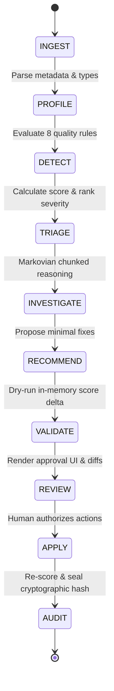

# DataGuard AI — Architecture & Engineering Specification

## 1. System Vision & Objective

DataGuard AI is an **Autonomous Data Reliability Engineer** engineered for mission-critical enterprise data estates. Modern data platforms suffer from silent data degradation: missing fields, duplicate customer records, inverted schema types, impossible numerical values, and temporal sequence violations. 

Unlike passive alerting tools that flood engineers with un-actionable Slack notifications, DataGuard AI operates as an active, bounded agent:
1. **Connects** to real data platforms (such as the Zetaris Spark federation network or object store files).
2. **Evaluates** data quality across 8 deterministic mathematical rules.
3. **Investigates** complex anomalies using constant-memory Markovian chunked reasoning ($O(1)$ scaling) and NVIDIA Nemotron empirical root-cause synthesis.
4. **Recommends** minimal, safe, parameterized remediation actions.
5. **Requires** explicit human authorization (Human-in-the-Loop) before touching any data.
6. **Executes** approved fixes exclusively on working copies (source data remains strictly read-only).
7. **Certifies** the result with cryptographic SHA-256 before/after seals and an immutable audit report.

---

## 2. Bounded 10-State Agent Lifecycle

DataGuard AI enforces an explicit, finite state machine:

### Detailed State Specifications:
1. **`INGEST`**: Safely loads records from either the live Zetaris Spark federation proxy (`/api/proxy/query/sql/start`) or standard tabular storage. Source data is treated as strictly read-only.
2. **`PROFILE`**: Computes distributions, distinct value cardinality, null ratios, and inferred data types across all columns.
3. **`DETECT`**: Runs the deterministic quality engine across all 8 rules simultaneously.
4. **`TRIAGE`**: Calculates the composite 0–100 reliability score and stratifies findings into `CRITICAL`, `HIGH`, `MEDIUM`, and `LOW` tiers.
5. **`INVESTIGATE`**: Dispatches anomalies to the **Meterless Markovian Engine** (chunked reasoning with bounded carryover state) and synthesizes empirical root-cause hypotheses with **NVIDIA Nemotron**.
6. **`RECOMMEND`**: Generates a catalog of non-destructive, parameter-driven repair actions (`DROP_DUPLICATES`, `FILL_NULL`, `CLAMP_BOUNDS`, `STANDARDIZE_FORMAT`, `NORMALIZE_CATEGORY`, `RESOLVE_CONTRADICTION`).
7. **`VALIDATE`**: Previews the proposed transformations against an isolated working copy to forecast the post-remediation quality score delta.
8. **`REVIEW`**: Halts the automated pipeline at an interactive human approval gate. Engineers inspect individual diffs and toggle approval checkboxes.
9. **`APPLY`**: Executes only the subset of transformations that received human approval on the working copy.
10. **`AUDIT`**: Re-evaluates quality rules on the remediated data, computes cryptographic SHA-256 hashes of both before and after states, logs human authorization events, and generates a compliance-grade audit report.

---

## 3. Deterministic Quality Engine (8 Foundational Rules)

| Rule # | Name | Category | Weight | Description |
|---|---|---|---|---|
| **Rule 1** | `NULL_CHECK` | Completeness | 20% | Detects missing values, NaN, nulls, and sentinel strings (`"N/A"`, `"null"`, `"-999"`). |
| **Rule 2** | `DUPLICATE_CHECK` | Uniqueness | 15% | Identifies exact duplicate rows and primary key collisions across critical identifiers. |
| **Rule 3** | `SCHEMA_TYPE_MISMATCH` | Validity | 15% | Flags corrupted strings in numeric fields or unparseable timestamps. |
| **Rule 4** | `BOUNDS_VIOLATION` | Validity | 15% | Detects values breaching domain constraints (e.g. negative age, churn score > 1.0, negative spend). |
| **Rule 5** | `FORMAT_INCONSISTENT` | Consistency | 10% | Flags mixed date representations (`YYYY-MM-DD` vs `MM/DD/YYYY`) and RFC-5322 non-compliant emails. |
| **Rule 6** | `CATEGORY_NORMALIZATION` | Consistency | 10% | Detects casing, whitespace, and synonym variations (e.g. `'Gold'`, `'gold'`, `'GOLD '`). |
| **Rule 7** | `STATISTICAL_OUTLIER` | Distribution | 10% | Uses Tukey's extreme IQR test ($Q_3 + 3.0 \times IQR$) to flag true anomalies without false alarms. |
| **Rule 8** | `SEMANTIC_CONTRADICTION` | Relational | 5% | Flags business logic impossibilities (e.g. `churn_date < signup_date` or active status with churn date). |

---

## 4. Security & Safety Model

1. **Non-Destructive Guarantee**: Original data sources (database tables, data lakes, original CSVs) are immutable. Transformations are executed strictly on cryptographic working copies.
2. **Zero Ingestion of Untrusted Code**: No dynamic `eval()` or unvalidated scripts are ever executed on datasets. All repairs utilize predefined vectorized Pandas routines.
3. **Cryptographic Sealing**: Both the input dataset and output dataset are hashed using `SHA-256(pd.util.hash_pandas_object)`. Any unauthorized external modification invalidates the audit certificate.
4. **Credential Isolation**: All access tokens and passwords are provided strictly via environment variables (`.env`). No secrets are committed to the codebase.

---

## 7. Universal Tabular Ingestion & Inferred Type System

DataGuard AI extends beyond fixed customer schemas to serve as a general-purpose dataset reliability agent:

### 7.1 Robust Ingestion Engine (`agent/profiler.py`)
- **Multi-Format Ingestion**: Supports CSV, TSV, and modern Excel formats (`.xlsx`, `.xls` via `openpyxl`). Handles direct file uploads via in-memory `io.BytesIO` streams as well as local file paths.
- **Encoding Resilience**: Evaluates multiple encoding codecs (`utf-8`, `utf-8-sig`, `latin-1`, `cp1252`) automatically.
- **Malformed Input Protection**: Empty files, zero-column schemas, and corrupted records raise clear user-facing diagnostics rather than unhandled tracebacks.

### 7.2 Semantic Type & Constraint Inference
- **Candidate Type Detection**: Probes non-null values to infer semantic data types (`numeric`, `integer`, `datetime`, `categorical`, `boolean`, `text`).
- **Interactive Schema Overrides**: Allows domain operators to adjust inferred types in the UI prior to audit execution.
- **Configurable Relational & Bounds Rules**: Supports custom numerical bounds (`custom_bounds`) and relational comparison logic (`custom_rules`, e.g. column A <= column B) alongside token-boundary domain inference (`age`, `price`, `qty`, `pct`).
- **Token-Boundary Heuristics**: Primary keys and temporal pairs use tokenized word boundaries (e.g. splitting on `_`, `-`, space) to avoid substring collisions (preventing columns like `humidity_pct` or `spend` from false positive matches).

### 7.3 Immutability & Human-in-the-Loop Remediation
- **Strict Read-Only Source Contract**: The original uploaded dataset is never mutated. All remediation actions are staged and executed on an isolated working copy.
- **Granular Authorization**: Every proposed remediation action includes before/after value previews and must be explicitly approved via UI toggles. Unchecked actions are marked `REJECTED_BY_USER`.
- **4-Way Export**: Cleansed datasets can be exported to CSV or Excel (`.xlsx`), accompanied by a Markdown Quality Report and a cryptographically sealed SHA-256 JSON Audit Trail.

---

## 8. Sequential AI Agent & Version Management Core

DataGuard AI orchestrates a sequential, guided preprocessing workflow:

### 8.1 The Sequential Investigation Queue (`agent/session_manager.py`)
- **Single-Issue Focus**: Issues are ranked by deterministic severity (`CRITICAL` -> `HIGH` -> `MEDIUM` -> `LOW`) and presented one at a time.
- **Contextual 'Why It Matters'**: Explanations are dynamically synthesized based on the operator's specified dataset goal:
  - *Machine Learning*: Risks of data leakage, variance distortion, matrix vectorization failures, and categorical explosion.
  - *Business Reporting*: Risks of revenue distortion, customer double-counting, KPI drop-offs, and LTV calculation errors.
  - *Data Analysis*: Risks of sample bias, distribution skew, and invalid statistical inferences.
- **Configurable Alternatives**: Every recommendation provides primary and alternative actions (e.g. Median vs Mean vs Mode vs Constant vs Row Drop vs Duplicates Flagging).

### 8.2 Version Tree & Immutability Guarantee
- **Read-Only Source Guarantee**: The uploaded dataset is locked into `v0` and never mutated.
- **Version Branching**: Every approved fix spawns a new version (`v1`, `v2`, ...).
- **Instant Rollback**: Operators can revert to any historical version at any point in time.

### 8.3 Redundancy Resolution Engine
- Whenever a transformation is applied, the deterministic quality engine re-evaluates the transformed working copy.
- If an earlier action resolved a subsequent defect, DataGuard AI automatically marks that issue as `AUTO_RESOLVED` with an explanatory note, preventing redundant fixes.

### 8.4 Natural-Language Revision Parser
- Interprets freeform English commands (e.g. *"Use median instead of mean"*, *"Keep duplicates but flag them"*, *"Convert dates to DD-MM-YYYY"*, *"Undo last change"*, *"Why did you recommend this"*).
- Previews the modified parameters and requests explicit confirmation.
